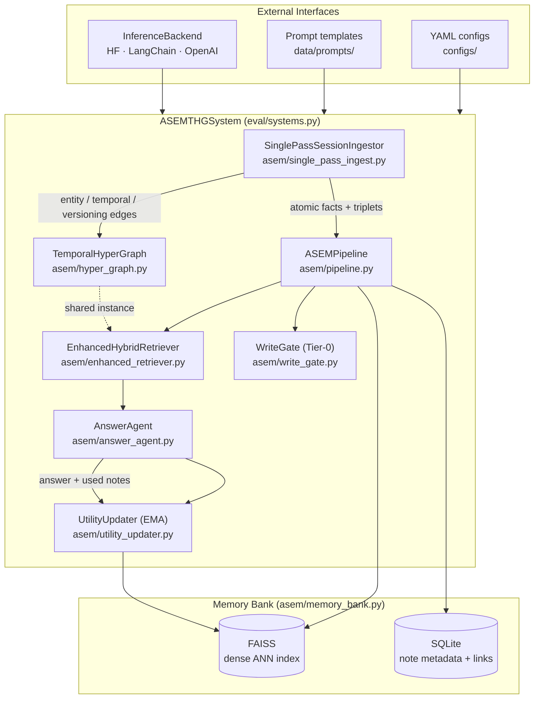
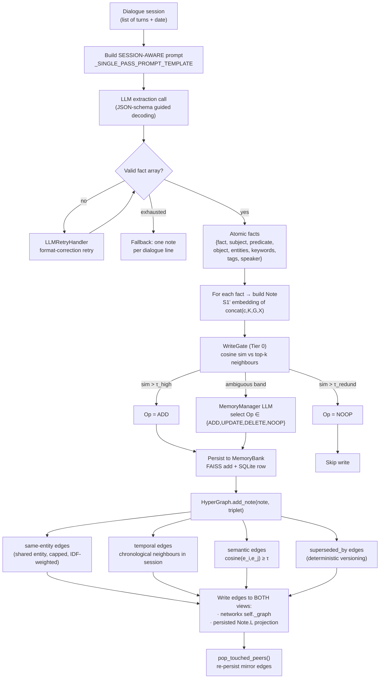
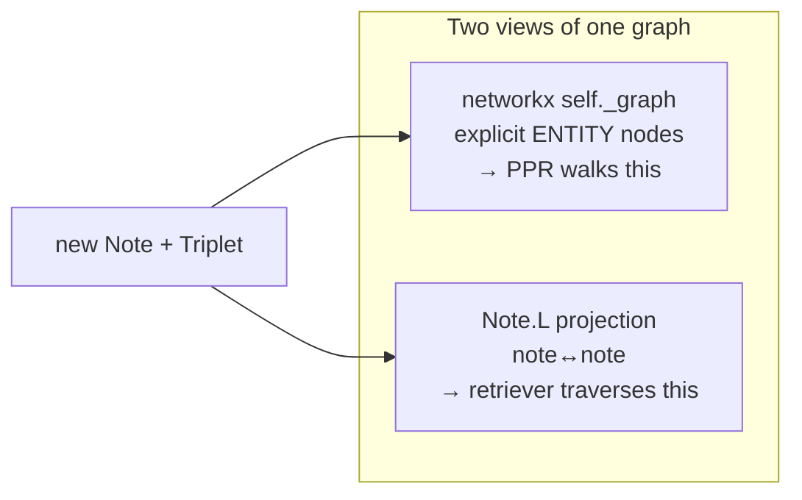
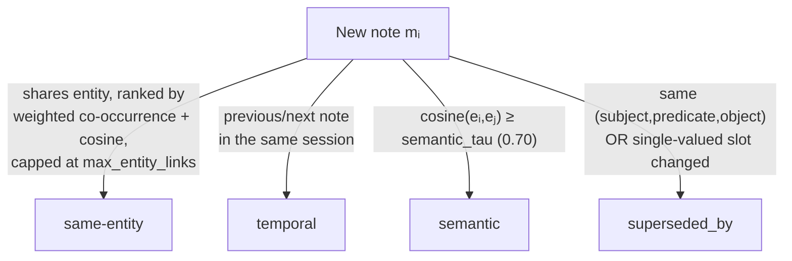
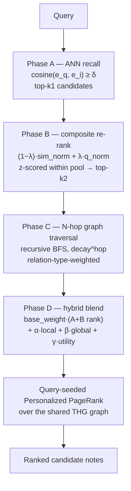
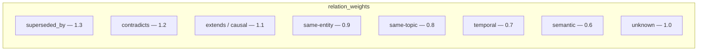
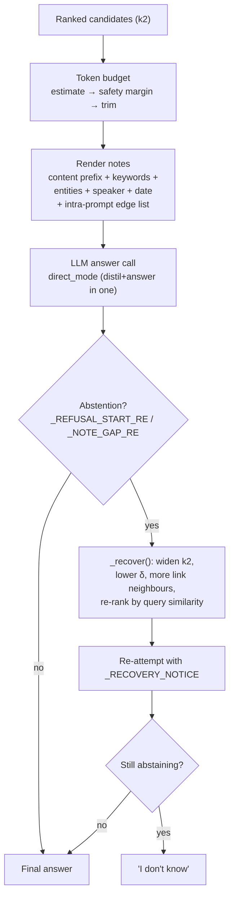
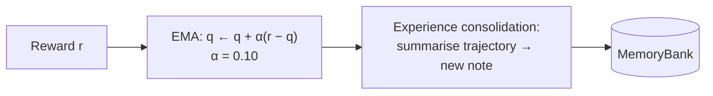
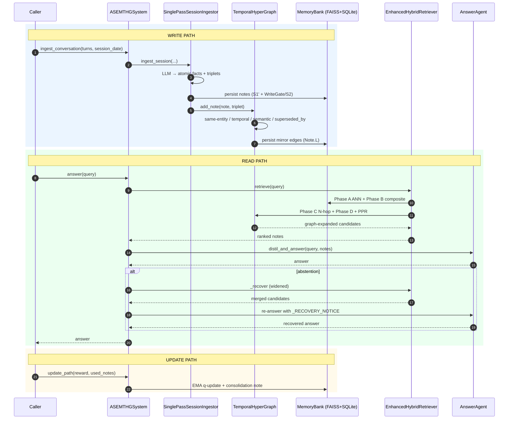

# ASEM-THG — System Architecture & Design Flow

> **Agentic Self-Evolving Memory with a Temporal Hyper-Graph**
> A frozen-backbone memory framework for LLM agents that organises dialogue turns
> into a deterministic, entity-aware, time-indexed knowledge graph and answers
> questions from a chronologically rendered, attribution-carrying note set.

---

## 1. Overview

**ASEM-THG** (Agentic Self-Evolving Memory — Temporal Hyper-Graph) is a
non-parametric memory system for long-horizon conversational agents. The backbone
LLM is **never fine-tuned**; all adaptation is externalised into a *memory bank*
(FAISS + SQLite) plus a *temporal hyper-graph* whose edges are built **without any
additional LLM linking calls**.

The design targets three recurring failure modes of long-conversation QA:

| Failure mode | ASEM-THG mechanism |
|---|---|
| Relative / shorthand dates are unanswerable later ("how many days between X and Y") | Single-pass extractor resolves every date to an **absolute calendar date** at ingest time |
| "Who said what" attribution is lost | Reactive/attribution turns are extracted as **first-class notes with a `speaker`** |
| Facts change over time (supersession) | Deterministic `(subject, predicate, object)` **versioning** edges |

### 1.1 Design goals

1. **One LLM call per ingestion session** — no per-note or per-pair linking cost.
2. **Deterministic graph construction** — the same session yields the same
   graph/bank (temperature pinned, structured JSON output).
3. **Graph-bounded recall** — dense entity hubs are down-weighted so the graph
   does not collapse into a clique.
4. **One answer budget for every system** — answering is a single model call, so
   context is trimmed to `answer.context_window − answer.max_tokens − safety`.
5. **Full observability** — retrieval-vs-generation attribution is recorded per
   query (`last_used_notes`, `last_retrieval_stats`).

---

## 2. Top-Level Architecture

The system exposes **three paths**, mirroring the ASEM five-stage pipeline:

| Path | Stages | Purpose |
|---|---|---|
| `ingest_conversation()` | S1 → S2 → S3 (single-pass) | Transform dialogue into graph-structured notes |
| `answer()` → `read_path()` | S4 | Retrieve, distil, answer (with recovery) |
| `update_path()` | S5 | EMA utility update + experience consolidation |

---

## 3. Ingestion Flow (Write Path)

ASEM-THG replaces the classic per-note construction + LLM linking with a
**single-pass, session-level extractor**.

### 3.1 Why one pass

The extractor prompt enforces five **hard rules** that make the resulting notes
self-sufficient (see `_SINGLE_PASS_PROMPT_TEMPLATE`):

1. **Resolve pronouns** — `"I went there"` → `"Caroline went to Hawaii"`.
2. **Resolve every date to an absolute calendar date** — inference of the year
   from the session date; relative wording (`yesterday`, `last Saturday`)
   anchored to the session date; **one date per fact**.
3. **One fact per note** — every distinct event, plan, preference, relationship
   becomes its own note (no thematic merging).
4. **Atomic triplet** — each fact carries `(subject, predicate, object)` so the
   graph can version it deterministically.
5. **Reactive / attribution turns** — the listener's reaction is captured with a
   `speaker` field (critical for misattribution questions).

### 3.2 Determinism contract

The ingestor pins `ingestion.temperature` and optionally requests
`response_format = json_schema`, so a bank built twice is byte-comparable. This
is required for frozen-bank evaluation (`static/memory_banks/<dataset>/<tag>/`).

---

## 4. The Temporal Hyper-Graph

`TemporalHyperGraph` (`asem/hyper_graph.py`) carries **four deterministic,
LLM-free relation types** and maintains **two views** of the *same* graph:

> Every relation is written to **both** views on purpose. A relation that lived
> only in the networkx graph would be silently lost across the process boundary
> between ingest and evaluation.

### 4.1 Relation types

| Relation | Rule | Guards |
|---|---|---|
| `same-entity` | Bridged by shared entity nodes | Fan-out cap; **hub suppression** via smoothed IDF floor |
| `temporal` | Chronological neighbours in one session | Session-local only |
| `semantic` | `cosine(e_i, e_j) ≥ 0.70` | Top-`max_semantic_links` |
| `superseded_by` | Restatement **or** single-valued replacement | Object must actually differ; predicate must be single-valued |

All emitted edges are **symmetric**, because the retriever only follows outgoing
links from a seed — a one-directional edge is invisible when the seed is the
older endpoint.

### 4.2 Hub suppression (graph selectivity)

A dominant entity (e.g. the conversation's own speaker) is shared by most notes;
an uncapped entity channel would collapse the graph into a clique. Peers are
ranked by **weighted co-occurrence + similarity** before the cut, and a shared
entity contributes its **smoothed IDF** — hubs are down-weighted rather than
severed, preserving the rare-entity tail.

### 4.3 Supersession is OFF by default

Config default is `hyper_graph.supersession: false`. Measured on the frozen
365-note LoCoMo bank: **0 of 5 supersession pairs were correct**, each marking a
still-true fact obsolete while `enhanced_retriever.relation_weights` promotes
`superseded_by` at the *highest* weight (1.3). The relation is retained as an
ablation toggle, not a default.

---

## 5. Retrieval Flow (Read Path)

Retrieval is staged: the classic **Phase A + B** of `HybridRetriever` are
preserved, and Phase C/D of `EnhancedHybridRetriever` add graph structure.

### 5.1 Scoring components

| Channel | Signal | Default weight |
|---|---|---|
| Local semantic (`alpha`) | Query–note similarity | 0.35 |
| Global graph (`beta`) | Louvain community + PageRank | 0.25 |
| Learned utility (`gamma`) | Note Q-value, intent-gated | 0.40 |
| Base rank (`base_weight`) | Preserved Phase A+B ordering | 0.60 |

### 5.2 Relation-aware traversal

Traversal multiplies the edge score by a **per-relation weight**:

A `multi_hop_min_sim` floor (0.30) prevents relevance-blind appends from
evicting gold notes when the graph is dense.

### 5.3 Query-seeded PPR

The global PageRank channel is **query-independent** — it rewards notes central
to the whole bank, not notes reachable from the query's evidence. `ppr_weight`
adds a **query-conditional** signal: Personalized PageRank seeded on the Phase
A+B winners, which is what surfaces the *other half* of a multi-hop fact.
`ppr_reverse` optionally adds the reversed walk ("what does this evidence rest
on?"). The retriever and ingestor **must share one graph instance**, or PPR walks
an empty structure.

---

## 6. Answer Flow

`AnswerAgent.distil_and_answer()` performs a single budgeted model call over the
retrieved notes, then the pipeline runs a **second-chance recovery** on refusal.

### 6.1 Context-budget discipline

`asem/token_budget.py` is shared by ASEM, ASEM-THG and every baseline (including
FullContext) so a comparison respects the **same number of tokens** for the
answer call. On overflow, the agent trims the tail (least relevant, because the
recovery pass re-sorts by similarity first).

### 6.2 Rendering optimisations (measured)

- `content` is truncated (`_CONTENT_CHAR_LIMIT = 200`) — it dominates the prompt
  but the decision procedure only skims `description`/`keywords`/`entities`.
- Dropped payload fields: `timestamp_iso`, `utility`, `tags` (redundant).
- Edge list: the **full** edge list was ~50% of the prompt; only edges *between
  notes in the same prompt* are actionable and kept verbatim, the rest collapse
  to a tiny relation-count map.

---

## 7. Utility Update (Stage 5)

After an answer is scored, `update_path(reward, used_notes, query, answer)` runs:

EMA (not TD learning) is used because the reward is a Monte Carlo exact-match
score over a non-stationary distribution; consolidation writes the trajectory
back as a new note, closing the self-evolution loop.

---

## 8. Component Reference

| Component | File | Responsibility |
|---|---|---|
| `ASEMTHGSystem` | `eval/systems.py` | Wires ingestor + pipeline; exposes `ingest_conversation` / `answer` / `reset` |
| `build_asem_thg_system` | `eval/systems.py` | Constructs one shared `TemporalHyperGraph` for ingest + retrieval |
| `SinglePassSessionIngestor` | `asem/single_pass_ingest.py` | Session → atomic facts + triplets (one LLM call) |
| `TemporalHyperGraph` | `asem/hyper_graph.py` | 4 deterministic relation types; dual view; PPR |
| `ASEMPipeline` | `asem/pipeline.py` | Orchestrates write/read/update paths + recovery |
| `EnhancedHybridRetriever` | `asem/enhanced_retriever.py` | 4-phase retrieval + PPR expansion |
| `HybridRetriever` | `asem/retriever.py` | Phase A (ANN) + Phase B (composite z-score) |
| `AnswerAgent` | `asem/answer_agent.py` | Budgeted distil+answer, abstention detection |
| `MemoryBank` | `asem/memory_bank.py` | FAISS ANN + SQLite metadata |
| `WriteGate` | `asem/write_gate.py` | Tier-0 deterministic write decision |
| `UtilityUpdater` | `asem/utility_updater.py` | EMA Q-update + consolidation |
| `InferenceBackend` | `asem/backends/` | HF / LangChain / OpenAI adapter |

---

## 9. Configuration Knobs

| Config key | Default | Effect |
|---|---|---|
| `hyper_graph.supersession` | `false` | Emit `superseded_by` edges (ablation) |
| `hyper_graph.entity_idf_floor` | `-inf` | Hub-suppression threshold |
| `retriever.k2` | 5 | Notes returned after Phase B |
| `retriever.max_hops` | 2 | N-hop traversal depth |
| `retriever.ppr_weight` | 0.15 | Query-seeded PPR contribution |
| `retriever.ppr_reverse` | `false` | Bidirectional personalization |
| `retriever.alpha / beta / gamma` | 0.35 / 0.25 / 0.40 | Local / global / utility blend |
| `answer.context_window` | — | Prompt budget (unset = no trimming) |
| `ingestion.temperature` | — | Pinned for reproducible graph builds |
| `write_gate.tau_high / tau_redund` | 0.45 / 0.92 | Tier-0 ADD / NOOP thresholds |

---

## 10. End-to-End Sequence

---

## 11. Related Documents

- `analysis/thg_evaluation_report.md` — six LoCoMo arms + LongMemEval, paired tests
- `analysis/graph_build_report.md` — bank-build provenance (`thg_v2`, `thg_v2_postfix`)
- `analysis/asem_thg_improvement_roadmap.md` — per-category, code-level improvements
- `analysis/adversarial_architecture_analysis.md` — root-cause analysis
- `THG_vs_FullContext_analysis.md` — head-to-head vs FullContext
- `CLAUDE.md` — build / run / evaluation commands
