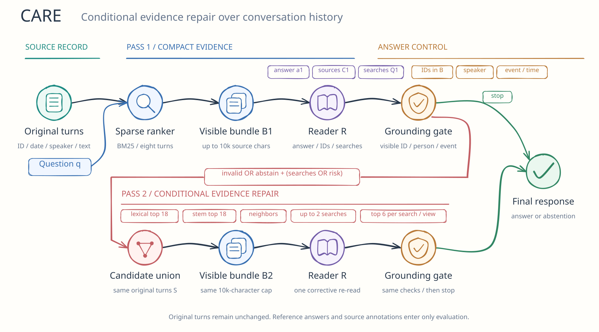

# Kiến trúc CARE: truy cập bằng chứng có điều kiện trên lịch sử hội thoại

## 1. Mục tiêu và phạm vi

CARE được thiết kế cho bài toán trả lời câu hỏi từ một lịch sử hội thoại dài hơn cửa sổ ngữ cảnh hữu hiệu của mô hình đọc. Ý tưởng trung tâm là giữ nguyên các lượt hội thoại làm nguồn chứng cứ có thể truy vết, chỉ đưa một tập lượt nhỏ vào mô hình ở lần đọc đầu, rồi mở rộng chứng cứ **một lần** nếu câu trả lời chưa được hỗ trợ hoặc có dấu hiệu thiếu nguồn. Đơn vị được tìm kiếm là *lượt hội thoại gốc*, không phải bản tóm tắt hoặc một “ký ức” được mô hình viết lại.

Kiến trúc gồm ba miền chức năng: **lưu trữ nguồn bền vững**, **truy cập chứng cứ thích nghi**, và **trả lời kèm kiểm tra ràng buộc nguồn**. Vòng sửa chỉ làm thay đổi tập chứng cứ được đọc cho câu hỏi hiện tại. Nó không cập nhật lịch sử hội thoại, tham số mô hình, hay một kho tri thức học được. Vì vậy, đóng góp của CARE nằm ở chính sách đọc và sửa bằng chứng tại thời điểm truy vấn.

*Hình 1.* Đường phía trên là lần đọc thường lệ. Đường phía dưới chỉ được kích hoạt khi cổng kiểm tra phát hiện lỗi nguồn hoặc khi câu trả lời từ chối đi kèm tín hiệu cần tìm thêm bằng chứng.

## 2. Mô hình dữ liệu và các bất biến

Với một cuộc hội thoại, gọi \(S=(s_1,\ldots,s_N)\) là dãy lượt gốc theo thứ tự thời gian. Một lượt được biểu diễn bởi

\[
s_i=(\mathrm{id}_i,\mathrm{session}_i,t_i,p_i,x_i,o_i),
\]

trong đó \(\mathrm{id}_i\) định danh duy nhất trong cuộc hội thoại, \(\mathrm{session}_i\) xác định phiên, \(t_i\) là ngày của phiên, \(p_i\) là người nói, \(x_i\) là nội dung văn bản, và \(o_i\) là vị trí gốc. Khi dữ liệu có chú thích ảnh, chú thích được nối vào văn bản của lượt tương ứng; hệ thống không suy luận trực tiếp từ điểm ảnh.

Các bất biến kiến trúc là:

1. **Nguồn bất biến:** một câu hỏi không làm sửa, tóm tắt lại hoặc loại bỏ các lượt trong \(S\).
2. **Định danh gắn với văn bản gốc:** mỗi lượt đưa vào mô hình giữ cùng người nói, ngày phiên và định danh nguồn.
3. **Chỉ trích dẫn nguồn đã nhìn thấy:** câu trả lời chỉ được trích dẫn những lượt thực sự có trong prompt của lần đọc tương ứng.
4. **Số lần đọc bị chặn:** mỗi câu hỏi dùng một hoặc hai lần gọi mô hình đọc; không có vòng lặp sửa vô hạn.
5. **Nhãn đáp án chuẩn chỉ dùng khi đánh giá:** câu trả lời tham chiếu và chú giải nguồn của bộ dữ liệu không đi vào đường suy luận.

Gọi \(P\subseteq S\) là *tập ứng viên* do bộ tìm kiếm thu thập, và \(B\subseteq P\) là *tập chứng cứ hiển thị* sau khi tuần tự hóa theo ngân sách ký tự. Phân biệt này quan trọng: một lượt có thể nằm trong \(P\) nhưng bị loại khỏi \(B\) vì giới hạn độ dài; sự có mặt trong tập ứng viên không đồng nghĩa với việc mô hình đã đọc lượt đó.

## 3. Các module và giao diện

| Module | Đầu vào | Xử lý chính | Đầu ra / cam kết |
|---|---|---|---|
| Kho lượt gốc | Các phiên hội thoại | Giữ văn bản, người nói, ngày, thứ tự và định danh của từng lượt | Dãy \(S\) bất biến, có thể truy vết về phát ngôn ban đầu |
| Chỉ mục thưa | \(S\) | Tạo biểu diễn từ vựng của nhãn người nói và văn bản; chuẩn bị thống kê tần suất từ và độ dài lượt | Hai cách nhìn từ vựng: từ gốc và từ sau rút gọn hình thái |
| Bộ xếp hạng lần đầu | Câu hỏi \(q\), chỉ mục từ gốc | Xếp hạng BM25, giữ thứ tự nguồn khi hòa điểm | Tối đa tám lượt được đề xuất cho lần đọc đầu |
| Bộ đóng gói chứng cứ | Các lượt được chọn | Ghi mỗi lượt dưới dạng định danh, ngày, người nói và văn bản; bỏ qua lượt vượt ngân sách còn lại | Tập hiển thị \(B\), tối đa 10.000 ký tự chứng cứ |
| Mô hình đọc có giao diện cấu trúc | \(q,B\), gợi ý ngày có thể tính được | Sinh câu trả lời ngắn, các nguồn đề xuất và tối đa hai truy vấn tìm chứng cứ còn thiếu | Bộ ba \((a,C,Q)\) |
| Cổng ràng buộc nguồn | \((a,C,Q)\), \(q\), \(B\) | Kiểm tra định dạng, nguồn hiển thị, người nói và một số neo sự kiện | Câu trả lời được giữ hoặc đổi thành từ chối kèm lý do lỗi |
| Bộ nhận diện rủi ro | \(q\), các lượt ứng viên ban đầu | Phát hiện dấu hiệu thời gian, cập nhật, tham chiếu chéo người nói và yêu cầu tổng hợp | Cờ \(\rho(q,P_1)\) hỗ trợ quyết định tìm thêm |
| Bộ mở rộng và sửa chứng cứ | \(q,Q\), chỉ mục, các lượt lân cận | Hợp nhất kết quả tìm theo từ gốc, từ rút gọn hình thái, truy vấn bổ sung và ngữ cảnh kề cận | Tập ứng viên mở rộng cho đúng một lần đọc lại |

Các module có vai trò tách biệt. Bộ tìm kiếm quyết định *lượt nào có khả năng liên quan*; bộ đóng gói quyết định *lượt nào thực sự được nhìn thấy*; mô hình đọc suy luận *đáp án nào có thể rút ra*; cổng kiểm tra quyết định *đáp án đó có đáp ứng một số điều kiện nguồn tối thiểu hay không*. Việc tách các vai trò này cho phép ghi nhận rõ lỗi thiếu nguồn và lỗi suy luận sau khi đã có nguồn.

## 4. Đường suy luận lần đầu

### 4.1. Tìm kiếm thưa theo lượt gốc

CARE tách từ trong nhãn người nói và nội dung lượt, bỏ các từ dừng thông dụng, rồi tính điểm BM25 cho từng lượt. Với từ \(w\) trong câu hỏi và lượt \(s_i\), cấu hình hiện tại sử dụng \(k_1=1.5\), \(b=0.75\):

\[
\operatorname{score}(q,s_i)=
\sum_{w\in q\cap s_i}
\log\!\left(1+\frac{N-\mathrm{df}(w)+0.5}{\mathrm{df}(w)+0.5}\right)
\frac{2.5 f_{wi}}{f_{wi}+1.5(0.25+0.75\ell_i/\bar\ell)}.
\]

Ở đây \(f_{wi}\) là số lần xuất hiện của từ \(w\) trong lượt \(i\), \(\ell_i\) là độ dài biểu diễn từ vựng của lượt đó, và \(\bar\ell\) là độ dài trung bình. Điểm hòa được giải theo thứ tự gốc trong hội thoại. Tám lượt đầu tạo thành ứng viên cho lần đọc thứ nhất. Ngoài ra, hệ thống xem một tập ứng viên rộng hơn để nhận diện rủi ro; tập này không mặc nhiên được gửi vào mô hình đọc.

### 4.2. Đóng gói và đọc chứng cứ

Mỗi lượt hiển thị mang đủ nhãn nguồn, ngày phiên và người nói trước nội dung. Điều này cho phép diễn giải các đại từ ngôi thứ nhất theo đúng người phát ngôn và có cơ sở để xử lý những mốc thời gian tương đối. Bộ đóng gói áp dụng trần 10.000 ký tự lên phần chứng cứ tuần tự hóa; lượt không vừa phần ngân sách còn lại sẽ bị bỏ qua, còn các lượt sau vẫn có thể được xét.

Mô hình đọc nhận câu hỏi và tập chứng cứ hiển thị \(B_1\), sau đó trả về giao diện cấu trúc

\[
(a_1,C_1,Q_1)=R_{\theta}(q,B_1), \qquad |Q_1|\leq 2.
\]

\(a_1\) là câu trả lời ngắn hoặc một giá trị từ chối khi thiếu thông tin; \(C_1\) là các định danh nguồn được đề xuất làm chứng cứ; \(Q_1\) gồm các truy vấn ngắn chỉ ra thông tin còn thiếu. Nếu câu trả lời đã có chứng cứ, giao diện yêu cầu \(Q_1\) rỗng. Truy vấn bổ sung không được chứa đáp án đoán trước. Văn bản nguồn được coi là dữ liệu, không phải chỉ dẫn cho mô hình.

Với các cụm như “last year” hoặc “next month” trong lượt có ngày phiên phân tích được, một phép tính xác định có thể cung cấp gợi ý ngày tuyệt đối gắn với chính lượt đó. Cơ chế này chỉ áp dụng cho một số cụm thời gian được nhận dạng rõ ràng; nó không suy ra ngày của sự kiện không được nêu trong nguồn.

## 5. Cổng kiểm tra và quyết định sửa

Cổng kiểm tra lọc \(C_1\) theo các định danh thật sự xuất hiện trong \(B_1\). Một câu trả lời khác từ chối phải còn ít nhất một nguồn hiển thị. Nếu câu hỏi nêu đúng một người nói, cổng kiểm tra dùng nhãn người nói và các dấu hiệu đại từ để hạn chế việc gán phát biểu “tôi” của người này cho người khác. Một số neo sự kiện được kiểm tra trực tiếp: khi câu hỏi nhắc tới một ngày lễ cụ thể, lượt được trích dẫn phải chứa ngày lễ đó; khi câu hỏi hỏi về việc dừng một hoạt động, lượt trích dẫn cần có dấu hiệu chấm dứt. Câu trả lời rỗng hoặc kết quả không phân tích được cũng bị đánh dấu lỗi.

Nếu một kiểm tra thất bại, câu trả lời của lần đọc đó được chuyển thành từ chối và ghi lý do để điều khiển lượt sửa. Đây là **bộ lọc lỗi hữu hạn theo quy tắc**, không phải phép chứng minh rằng toàn bộ nội dung câu trả lời được suy ra logic từ các nguồn. Một nguồn đúng định dạng vẫn có thể không đủ để chứng minh đáp án; ngược lại, quy tắc bảo thủ có thể từ chối một đáp án đúng.

Cờ rủi ro \(\rho(q,P_1)\) được bật khi câu hỏi hoặc các ứng viên ban đầu có dấu hiệu thời gian, thay đổi trạng thái, tham chiếu giữa nhiều người nói, hoặc yêu cầu liệt kê/tổng hợp. Gọi \(r_1\) là lỗi định dạng hay lỗi ràng buộc nguồn của lần đọc đầu, và \(\bot\) là câu trả lời từ chối. CARE quyết định mở rộng chứng cứ bằng

\[
\tau(q)=\mathbf{1}\!\left[
r_1\;\lor\;
\bigl(a_1=\bot\;\land\;(Q_1\neq\varnothing\;\lor\;\rho(q,P_1))\bigr)
\right].
\]

Do đó, một đáp án vượt qua cổng kiểm tra dừng sau một lần đọc, kể cả khi câu hỏi có dấu hiệu rủi ro. Một câu trả lời từ chối mà không kèm truy vấn tìm thêm hay cờ rủi ro cũng dừng. Chính sách này dành lần gọi thứ hai cho trường hợp có lỗi rõ ràng hoặc có cơ sở cho rằng tập chứng cứ ban đầu chưa đủ.

## 6. Đường mở rộng chứng cứ và đọc lại

Khi \(\tau(q)=1\), CARE tạo tập ứng viên mở rộng từ bốn nguồn thông tin:

1. Tối đa 18 lượt đứng đầu theo BM25 trên từ gốc.
2. Tối đa 18 lượt đứng đầu theo BM25 trên từ đã rút gọn hình thái.
3. Các lượt liền kề trong cùng phiên của bốn kết quả đầu ở mỗi cách xếp hạng.
4. Với tối đa hai truy vấn do mô hình đọc đề xuất, tối đa sáu kết quả theo mỗi cách xếp hạng; nếu không có truy vấn đề xuất, dùng lại câu hỏi gốc. Khi câu hỏi chỉ nêu một người nói, tên người đó được thêm vào truy vấn còn thiếu tên.

Sau khi hợp nhất và khử trùng lặp, các lượt được sắp trở lại thứ tự hội thoại gốc. Bộ đóng gói tiếp tục áp dụng cùng trần 10.000 ký tự; vì vậy, *tập ứng viên mở rộng* có thể lớn hơn đáng kể *tập được mô hình đọc lần hai nhìn thấy*. Mô hình đọc nhận thêm một chỉ dẫn sửa tập trung vào người, sự kiện và thời gian; nếu lỗi đầu tiên là gán nhầm người nói, chỉ dẫn nhấn mạnh kiểm tra nhãn người nói. Đầu ra thứ hai đi qua cùng cổng kiểm tra rồi trở thành đáp án cuối hoặc câu trả lời từ chối. Không có lần sửa thứ ba.

Quy trình có thể tóm tắt bằng chuỗi trạng thái:

\[
q \longrightarrow P_1 \longrightarrow B_1 \longrightarrow
(a_1,C_1,Q_1) \longrightarrow \text{kiểm tra}
\begin{cases}
\longrightarrow \text{đầu ra}, & \tau(q)=0,\\
\longrightarrow P_2 \longrightarrow B_2 \longrightarrow
(a_2,C_2,Q_2) \longrightarrow \text{kiểm tra} \longrightarrow \text{đầu ra},
& \tau(q)=1.
\end{cases}
\]

## 7. Minh họa đường đi của một câu hỏi

Trong thí nghiệm, với câu hỏi về việc Nate đã nuôi những con rùa trong bao lâu, lượt đọc đầu không tìm đủ chứng cứ để trả lời và đưa ra truy vấn tìm thời điểm Nate bắt đầu nuôi chúng. Nhánh sửa mở rộng tập ứng viên, đưa vào một lượt có ngày phiên và phát biểu trực tiếp rằng anh đã nuôi rùa được ba năm. Lượt đọc thứ hai trả lời “ba năm” và dẫn chính lượt đó. Ở ví dụ này, tín hiệu thiếu nguồn đã điều khiển một lần tìm bổ sung hữu ích.

Chiều ngược lại cũng xuất hiện: câu hỏi về số xe Prius mà Evan từng sở hữu có các lượt liên quan trong tập chứng cứ, nhưng CARE vẫn từ chối sau hai lần đọc. Trường hợp này cho thấy kiến trúc phải phân biệt **lỗi tìm chứng cứ** với **lỗi suy luận hoặc chính sách trả lời sau khi đã thấy chứng cứ**. Nhánh sửa có thể cải thiện trường hợp thứ nhất; nó không bảo đảm khắc phục trường hợp thứ hai.

## 8. Ngân sách tài nguyên và đặc tính vận hành

| Thành phần ngân sách | Thiết kế hiện tại | Hệ quả kiến trúc |
|---|---:|---|
| Lượt đưa vào lần đọc đầu | Tối đa 8 | Chi phí prompt thường lệ thấp; có nguy cơ bỏ sót chứng cứ nằm xa trong bảng xếp hạng |
| Tập hạt giống khi sửa | 18 kết quả cho mỗi cách nhìn từ vựng | Tăng độ bao phủ khi có dấu hiệu thiếu nguồn |
| Truy vấn sửa do mô hình đề xuất | Tối đa 2 | Giữ vòng tìm kiếm có giới hạn rõ ràng |
| Chứng cứ hiển thị mỗi lần đọc | Tối đa 10.000 ký tự | Tách độ rộng tìm kiếm khỏi độ dài prompt thực tế |
| Số lần gọi mô hình đọc | 1 hoặc 2 | Chặn chi phí suy luận trên mỗi câu hỏi |
| Mô hình nhúng bổ trợ | Không dùng trong CARE | Chỉ mục dựa trên từ vựng; chi phí tìm kiếm nằm ở quét và xếp hạng lượt |

Chỉ mục từ vựng được tạo từ các lượt của cuộc hội thoại trước khi trả lời. Mỗi lần xếp hạng hiện duyệt các lượt trong hội thoại, nên chi phí tìm kiếm tăng theo số lượt và số lần chạy truy vấn. Lượt sửa thực hiện thêm các phép xếp hạng và có thể tốn nhiều tính toán cục bộ hơn lần đọc đầu. Chi phí mô hình ngôn ngữ vẫn được kiểm soát bởi tối đa hai lần đọc và ngân sách chứng cứ cố định.

Trên 1.986 câu hỏi trong phép đánh giá hiện tại, 1.004 câu kích hoạt lượt sửa, tương ứng 2.990 lần gọi mô hình đọc hay trung bình 1,506 lần gọi mỗi câu. Đây là **số liệu quan sát** của tập đánh giá, không phải một tham số cố định của kiến trúc. Tương tự, ngưỡng 10.000 ký tự là ràng buộc thiết kế, còn số token thực tế phụ thuộc bộ tách token và nội dung từng câu hỏi.

## 9. Ý nghĩa phương pháp và các giới hạn

CARE tạo ra một quan hệ điều khiển cụ thể giữa truy hồi và sinh đáp án: mô hình đọc vừa trả lời vừa cung cấp tín hiệu về khoảng trống bằng chứng; bộ kiểm tra chuyển các lỗi ràng buộc nguồn thành điều kiện sửa; bộ mở rộng chỉ được chạy khi điều kiện đó thỏa. Tính mới nằm ở **quyết định đọc lại có điều kiện trên nguồn hội thoại gốc**, thay vì chỉ chọn một tập top-\(k\) cố định cho mọi câu hỏi.

Khả năng giải thích của đầu ra đến từ việc giữ người nói, thời gian và định danh nguồn qua toàn bộ đường suy luận. Tuy nhiên, định danh nguồn là một điểm truy vết, không phải bằng chứng hình thức về quan hệ kéo theo. Kiểm tra người nói và sự kiện chỉ bao phủ những trường hợp được mã hóa trong quy tắc; việc nối các quan hệ nhiều bước hoặc xử lý cập nhật ngầm vẫn phụ thuộc mô hình đọc. Bộ tìm kiếm từ vựng cũng có thể bỏ sót bằng chứng diễn đạt bằng từ đồng nghĩa, và trần ký tự có thể khiến một lượt liên quan không xuất hiện trong prompt dù đã được tìm thấy.

Vì thế, khi mô tả đóng góp học thuật, CARE nên được định vị là một **kiến trúc điều phối chứng cứ và kiểm tra nguồn có ngân sách**, áp dụng cho việc trả lời câu hỏi từ hội thoại dài. Nó chưa chứng minh một cơ chế tự tiến hóa của kho nhớ; việc học hoặc viết lại bộ nhớ cần một đường cập nhật riêng cùng thí nghiệm tách biệt.
